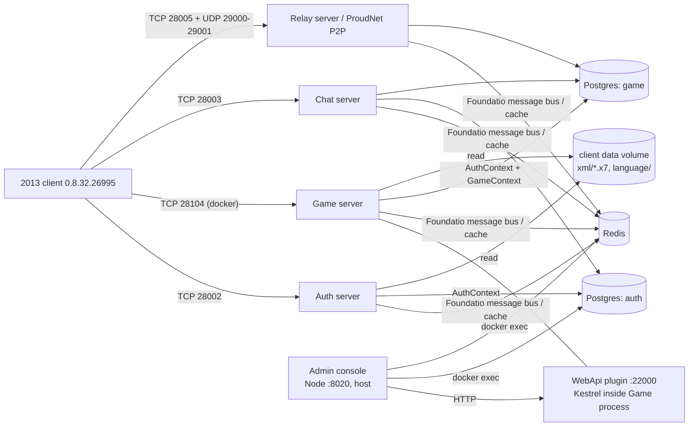

# OpenS4L — Technical Audit (read-only)

Audited: `github.com/Nergy101/OpenS4League` @ `36a8489` (last commit 2026-09-19; history starts 2026-08-21; 2 committers, effectively one maintainer).
Method: full read of CLAUDE.md, README.md, Server/README.md, Server/PLUGINS.md, Docker stack, DB layer, all four servers, plugins, tests, admin console. **No files were modified. Nothing was built or run** (see §10 for why).

## Classification legend

| Tag | Meaning |
|---|---|
| **T** | Implemented and tested — covered by the repo's automated tests (in-memory transport fakes / Testcontainers). *No feature in this repo is documented as verified with the real 2013 client.* |
| **U** | Implemented but not verified with a real client — code exists, no automated test, never confirmed end-to-end |
| **P** | Partially implemented — stubs, TODOs, zeroed formulas, known bugs |
| **M** | Missing |

Key fact: `Server/README.md` Phase 5 ("Client connects; login, character creation, room join (relay), shop purchase all succeed") and the Phase 1 smoke test are **unchecked**. The LoadBot speaks the real protocol but only does login → char create → channel → chat. **No room, match, relay or shop flow has ever been exercised by anything other than unit tests.**

---

## 1. Architecture



Layering: `ProudNet` (in-repo reimplementation, DotNetty) → `OpenS4L.Network` (opcodes/serializers, protocol surface) → 4 generic-host servers. Shared: `OpenS4L.Common` (config/crypto/plugin host), `OpenS4L.Database` (EF Core 10/Npgsql), `OpenS4L.Resource`, `OpenS4L.Blub` (decompiled BlubLib port). Cross-server IPC is Redis pub/sub only. Player saves go through a Redis write-behind queue.

Session flow: Auth issues a random session id → Redis `session_{accountId}` (30 min TTL) → Game validates it → Game announces itself to Auth's server list over the bus → Relay asks Game over the bus to validate (account/nick/room ids, **no token**).

## 2. Feature inventory

| Area | Feature | Status | Evidence / notes |
|---|---|---|---|
| Build | Solution compiles on net10.0 | per README | Not reproduced here (no .NET 10 SDK on this Mac) |
| Auth | Login (PBKDF2), ban check, login history, session id | **U** | `Auth/Handlers/AuthenticationHandler.cs`; Auth project not referenced by tests; LoadBot exercises happy path |
| Auth | Server list via Redis bus | **U** | `Auth/Services/ServerlistService.cs` |
| Auth | Public registration (HTTP/web) | **M** | Only `createaccount` GM command + provisioner SQL |
| Auth | Rate limiting / lockout | **M** | |
| Game | Game login (session/version/ban/dup-login) | **T** (happy path only) | `GameAuthenticationHandlerTests` (1 test) |
| Game | First character + nickname | **T/P** | happy path tested; nickname rules untested; char created before nick validated; `NickCheckReq` unhandled |
| Game | Character slots (max 3) | **T** | `GameCharacterTests`, `GameCharacterHandlerTests` |
| Game | Channels list/enter/leave | **T** | `GameChannelHandlerTests`, `GameRoomTests` |
| Rooms | Create/join/leave/ready/team/start | **T** | `GameRoomTests`, `GameRoomHandlerTests` |
| Rooms | Kick | **P (bug)** | `RoomHandler.cs:415` uses `&&` → any non-master can kick in lobby (verified by reading) |
| Rooms | Arcade create, quick join, vote kick | **M** | TODO at `RoomHandler.cs:79` |
| Match | State machine (halves, result) | **T** (start only) | 2 tests; half-time/result untested |
| Match | Deathmatch, Touchdown, BattleRoyal, Captain | **U** | logic present, zero tests on scoring |
| Match | Practice | **U/P** | 1-player, no rewards |
| Match | Chaser, Survival, Siege, Arena, Conquest, etc. | **M** | only 5 rules registered in `GameRuleResolver.cs` |
| Match | EXP rewards | **U** | per-rule formula |
| Match | PEN rewards | **P** | every rule returns `(0,0)` — no PEN ever earned |
| Match | Durability loss | **P** | code exists, config sets 0 |
| Match | Server-side kill/damage validation | **M** | kills reported by victim, accepted; goals from room master |
| Relay | P2P group / relay | **U** | no tests, LoadBot never touches relay |
| Shop | Buy with PEN / AP | **T** | `GameShopHandlerTests` (3) |
| Shop | Other price types (coins) | **M** | TODO `ShopHandler.cs:129` |
| Shop | Catalog | **P** | provisioner seeds a **free, permanent** shop of every item; no priced catalog |
| Inventory | Equip/unequip | **T** | `GameInventoryHandlerTests` |
| Inventory | Repair / refund | **P** | costs hard-coded to 0 (`PlayerItem.cs:150-161`) |
| Inventory | Period item expiry | **P/M** | ExpireDate computed, never enforced; client gets MinValue |
| Inventory | Licenses | **P** | all licenses granted at login |
| Inventory | Enchant, capsules, coins, nick change item | **M** | unhandled |
| Currency | PEN, AP, Coins1/2 columns | **T** (storage) | coins never spendable |
| Profile | Level/EXP persisted | **T** | `GamePlayerMethodTests` |
| Profile | Kills/deaths/wins persisted | **M** | in-memory per match only, no tables |
| Rankings | Player/clan leaderboards | **M** | no code, no tables |
| Clans | Create/join/leave/approve/kick/ban/notice | **T** | `GameClan*Tests` (13) |
| Clans | Board, invite, master change, rank list, clan chat | **M** | unhandled; club chat commented out |
| Social | Friends, deny list | **T** | `ChatFriend*Tests` |
| Social | Channel chat, whisper | **T** | `ChatHandlerIntegrationTests` |
| Social | Mail/notes | **P (bug)** | `Mailbox.SendAsync` adds row but never `SaveChangesAsync` → mail lost on restart (verified by reading); test only checks return value |
| Admin | GM commands: gm, announce, kick, ban, unban, shutdown, reloadshop, createaccount, game-state debug | **T** (most) | `GameCommandTests`, `GameCommandPostgresTests` |
| Admin | Give item / PEN / set level | **M** | |
| Admin | WebApi kick/ban/roomkick/closeroom | **T** | Verify snapshot + stateful tests; **no authentication** |
| Admin | Admin console (status, logs, DB/Redis read-only browser, moderation) | **U** | Node, **no auth**, listens on all interfaces |
| Admin | Audit log of admin actions | **M** | |
| Ops | Docker stack + provisioner | **U** on macOS | not run here |
| Ops | CI build/test | **M** | only a website deploy workflow |
| Anti-cheat | GameGuard/XignCode messages | **M** | unhandled; no server-side substitute |

Approx. 150 client request message types have no handler (logged at Debug and ignored).

## 3. Database schema

Two databases, one migration each (`20260819165614_Initial` auth, `20260819165627_Initial` game), applied automatically at startup (`RunMigration: true` everywhere).

**auth**: `accounts` (Id, Username unique, Nickname unique nullable, Password, Salt, SecurityLevel 0–3), `bans` (AccountId, Date, Duration null=perm, Reason), `login_history` (AccountId, Date, IP varchar(15) — IPv4 only), `nickname_history` (reservations).

**game**: `players` (Id = account id, TotalExperience, PEN, AP, Coins1, Coins2, TutorialState, CurrentCharacterSlot — no level/nickname columns), `player_characters` (slot, gender, FKs to equipped items), `player_items` (ShopItemInfoId, ShopPriceId, Effects, Color, PurchaseDate, Durability, MP), `player_mails`, `player_friends`, `player_deny`, `player_settings`, `shop_items`, `shop_iteminfos`, `shop_price_groups`, `shop_prices`, `shop_effect_groups`, `shop_effects`, `shop_version`, `start_items`, `level_rewards`, `channels`, `clans`, `clan_members`, `clan_bans`, `clan_events`.

**Not present:** stats, match history, rankings, transactions/currency ledger, admin audit log, email/verification fields.

Item definitions/maps/levels come from client `*.x7` XML (data volume); prices come from DB.

## 4. Authentication & player creation flow

1. Client → Auth `LoginEUReq` (username + password in the message). Username lowercased; unknown user → WrongLogin (**no auto-register**).
2. PBKDF2-HMAC-SHA1, 24 000 iterations, 24-byte salt/key, constant-time compare.
3. Ban check → login_history row → 16-byte random session id stored in Redis (30 min TTL, not consumed after use).
4. Client gets server list (from Redis bus announcements), connects to Game with `{AccountId, SessionId, Version}`.
5. Game checks version, MaxSessions, session id, ban, duplicate login; auto-creates `players` row with StartPEN 30 000.
6. No nickname → `CharacterFirstCreateReq`: creates slot-0 character, grants `start_items` chosen by client (filtered by gender/security level), fallback dagger+skill; validates nickname (4–30 ASCII, not taken/reserved), writes `accounts.Nickname`.
7. Accounts today: only the provisioner (`admin/admin`, bots) and the `createaccount` GM command — which **does not lowercase** the username, so mixed-case accounts can never log in (read, not tested).

## 5. Room & match flow

Channel enter → `RoomMakeReq2` (rule/map validated; player/time/score limits not range-checked) → join (password, GM bypass) → team/ready → master starts (equip validation) → Loading → Starting (5 s) → FirstHalf → HalfTime (25 s) → SecondHalf → Result (15 s) → Waiting. `OnResult` awards EXP (+ level rewards from `level_rewards`); PEN is zero. Relay joins the player to a ProudNet P2P group; gameplay traffic is relayed uninspected. Scores are client-reported (`Score*` messages) with only "is in room / is alive" checks.

## 6. Inventory & shop status

Buy (PEN/AP) works in tests. Catalog is the provisioner's free shop. Repair/refund free/zero. No period expiry enforcement, no license gating, no enchant/capsules/coins. No currency ledger — PEN/AP are just columns mutated in memory and saved by write-behind.

## 7. Admin capabilities

- In-game GM commands (see table above) gated by SecurityLevel.
- WebApi (inside Game process, `0.0.0.0:22000`): GET statistics/channels/rooms/players/gamedata; POST `/admin/kick|ban|roomkick|closeroom` — **unauthenticated**. Docker only publishes it on 127.0.0.1.
- Admin console (Node, `:8020`, all interfaces, **no auth**): live status, history chart, log tail, read-only Postgres/Redis browser via `docker exec`, moderation tab forwarding to WebApi. Port detection reads source configs (Game 28004) while Docker uses 28104 — game status will show "down".

## 8. Extension points

- **Plugins**: `IPlugin` (`OnInitialize/OnConfigure/OnShutdown`) DLLs in each server's `plugins/` folder; `{Auth,Chat,Game,Relay}PluginBase.targets` exist, so an **Auth plugin is possible** (good home for HTTP registration).
- **Game hooks** (`EventPipeline`): `GameRuleStateMachine.ScheduleTriggerHook`, `Channel.JoinHook`, `EquipValidator.IsValidHook`, `RoomManager.RoomCreateHook`, `GameRuleBase.CanStartGameHook`, `GameRuleBase.HasEnoughPlayersHook`, `Room.JoinHook`, `Room.ChangeRulesHook`; events `RoomManager.RoomCreated/RoomRemoved` (Game & Relay). **No hooks on match result, kill, purchase, login** — stats/economy work will need new hooks in core (small, deliberate changes).
- **Game rules**: register a `GameRuleBase` subclass via DI (see ExamplePlugin).
- **WebApi**: minimal-API `Endpoints.cs`; contracts pinned by Verify snapshots.
- **Redis bus**: any service can subscribe to Foundatio messages.

## 9. Missing functionality (vs. your goals)

Public registration & email verification · rate limiting/captcha · authenticated admin APIs · audit log · PEN economy (rewards, repair, refund, expiry) · priced shop management · persistent stats, match history · rankings/leaderboards · clan board/invite/master change/rankings/clan chat · player profile page · anti-cheat plausibility checks · CI · public-network config (all advertised addresses are 127.0.0.1) · payments (blocked by policy, correctly).

## 10. macOS / Docker compatibility

| Item | Finding |
|---|---|
| .NET SDK on this Mac | **8.0.405 only** — .NET 10 SDK required; build not attempted |
| Docker daemon | **not running** at audit time |
| Images | `postgres:16`, `redis:7-alpine`, `mcr.microsoft.com/dotnet/aspnet:10.0`, `python:3.12-slim` — all multi-arch (arm64 OK); no `platform:` pins |
| Publish | framework-dependent `dotnet *.dll` (RIDs `win-x64;linux-x64` in csproj, but not used by publish) |
| **Native risk** | `SharpLzo 0.1.2` (P/Invoke LZO, used to compress shop data sent to client) is **only on the personal `wtfblub` MyGet feed**, not nuget.org. Whether it ships a `linux-arm64` native lib is **unverified** — if not, shop loading fails in arm64 containers. Fallback: `platform: linux/amd64` (Rosetta) or a managed LZO. |
| Python 3 | required by Makefiles (help, plugin staging) |
| Windows bits | only `cygpath` handling; harmless on macOS |
| Ports | all published on 127.0.0.1; Redis on host 6380 |

## 11. Exact steps to run locally (macOS, M3) — not yet executed

```bash
# 1. prerequisites
brew install --cask dotnet-sdk          # must give a 10.0.x SDK; check:
dotnet --list-sdks
brew install pnpm python                # pnpm only for the admin console
open -a Docker                          # start Docker Desktop

# 2. source
git clone https://github.com/Nergy101/OpenS4League.git ~/Desktop/opens4l && cd ~/Desktop/opens4l

# 3. build + unit tests (Postgres tests need Docker running)
make -C Server build
make test

# 4. client data: extract xml/ and language/ from YOUR OWN client's resource.s4hd
make -C Tools/s4l-resource-tool run     # GUI extractor
make -C Server/Docker data SRC=/path/to/extracted-client-data

# 5. full stack: publish, stage plugins, compose up, provision admin/admin + free shop
make -C Server/Docker bootstrap
docker compose -f Server/Docker/compose.yaml ps
make -C Server/Docker logs

# 6. protocol smoke test with simulated players
make -C Server/Docker provision-bots BOTS=10
make -C Server/Docker loadbot USERPREFIX=bot BOTS=10

# 7. admin console (localhost only — it has no auth)
cd Tools/s4l-admin-console/web && pnpm install && pnpm run build && node ../server/server.js
```

Expected snags: SharpLzo native lib on arm64; admin console shows Game "down" (28004 vs 28104); real client must be pointed at `127.0.0.1:28002` (client-side config method not audited).

## 12. Risks & blockers

1. **Legal / IP (highest).** The game, client and assets belong to their rights holder(s) (repo credits Nexon — confirm the actual current holder). Running a public server, and especially monetising it, needs permission. Players need the client, which you can't distribute → onboarding blocker. `OpenS4L.Blub` is **decompiled** copyrighted code; NetspherePirates' license must be checked before you publicly host derived binaries.
2. **Nothing is proven with a real client.** All "works" claims rest on in-memory tests and a login-only load bot.
3. **Security before any exposure:** unauthenticated WebApi/admin console, default creds everywhere (`postgres/1234`, `admin/admin`, Redis no password, superuser DB role), PBKDF2-SHA1 24k, no login throttling, handlers without login firewall (Shop/Inventory/P2P/ClubInfo — possible null-crash DoS), relay login without session token.
4. **Client-authoritative scoring** → trivial stat/EXP cheating; makes leaderboards and economy meaningless until mitigated.
5. **Upstream fragility:** ~3-month-old repo, single maintainer, no CI, ~300 vulnerable/deprecated package warnings (Newtonsoft 11, BouncyCastle 1.8, Serilog 2.7), DotNetty (unmaintained), SharpLzo on a personal feed.
6. **Known bugs:** room kick permission, mail not persisted, `createaccount` casing, `UserDataOneReq` null crash, `login_history.IP` length.
7. **Public networking:** advertised IPs are 127.0.0.1; relay UDP behind Docker/NAT may need host networking (README itself warns).

---

# Proposed implementation plan

Order = unblock verification → make safe → make public → make it a game worth playing. Each milestone keeps protocol byte-compatibility; core changes are minimal and deliberate, everything else as plugins/migrations.

### M0 — Reproducible build & CI (fork)
- Fork upstream; install .NET 10 SDK; resolve SharpLzo on arm64 (verify, else amd64 pin or vendor package to a feed you control).
- Add GitHub Actions: build + `make test` on ubuntu (amd64) and macos-14 (arm64).
- **Accept:** `make -C Server build` 0 errors on M3; `make test` passes with recorded count (and zero unexpected failures); CI green on both OSes; `make -C Server/Docker bootstrap` → 6 containers up, `provision` exits 0; LoadBot 10 bots complete `single-channel` and `chat` with 0 errors.

### M1 — Real-client verification baseline
- Using a client copy the team legally owns (never committed), run a written test matrix on 2 machines.
- **Accept:** documented pass/fail for: login, wrong password, ban, nickname, char create, channel, chat/whisper, room create (DM, TD, BR, Captain), 2-player full match through relay to result screen, EXP persisted after server restart, shop purchase persisted, equip, clan create/join. Every feature in §2 re-tagged with this evidence. Failures become tickets.

### M2 — Security hardening (gate for any non-localhost exposure)
- WebApi: API-key/JWT auth + bind to localhost by default; admin console: login + bind 127.0.0.1; secrets to `.env`/Docker secrets; per-service least-privilege DB roles; Redis password.
- Password hash → PBKDF2-SHA256 ≥ 600k with transparent re-hash on login; login throttling per IP/account; `MustBeLoggedIn` on Shop/Inventory/P2P/Club handlers; relay validates a session token.
- Fix: kick `&&`→`||`, mail `SaveChangesAsync`, `createaccount` lowercase, null crashes, IP column width.
- **Accept:** unauthenticated WebApi/console calls return 401 (tests); no default credential remains in tracked files (grep check in CI); new tests for each bug fix fail before/pass after; 10 bad logins/min from one IP are throttled; existing tests still green.

### M3 — Public registration & account portal
- Auth-server plugin (or separate small service sharing AuthContext) exposing `POST /register`, email verification, password reset; captcha; nickname reserved at registration or kept in-game.
- **Accept:** new user registers via web, verifies email, logs in with real client; duplicate/case-variant usernames rejected; rate limit enforced; integration tests against Postgres.

### M4 — Public hosting
- Config for public advertised addresses (auth server list, game, relay UDP), Linux VPS deployment (amd64), TLS reverse proxy for HTTP surfaces, backups.
- **Accept:** two clients on different home networks complete a full match; daily Postgres backup restorable; only game ports + 443 open (port scan).

### M5 — Economy (PEN / AP, no real money)
- Configurable PEN per match; repair/refund formulas; period-item expiry job; license enforcement; priced shop managed from DB/admin; AP grantable only by admins; **currency ledger table** for every PEN/AP change.
- **Accept:** match result grants expected PEN (unit tests per rule); ledger sum equals balance for all players (consistency check job); expired items removed and not equippable; shop prices editable without rebuild (`reloadshop`).

### M6 — Stats, profiles, leaderboards
- New core hook `OnMatchResult`; `player_stats` + `match_history` tables (migration); WebApi read endpoints; website leaderboard/profile pages.
- **Accept:** after a real match, K/D/W/L and TD scores persist and match WebApi; leaderboard endpoint < 100 ms at 10k players (seeded); snapshot tests updated deliberately.

### M7 — Anti-cheat baseline
- Plausibility checks on `Score*` (rate caps, kills-per-minute, self-credit patterns), report-player flow, flag queue in admin.
- **Accept:** scripted cheating bot (forged kill reports) is rejected/flagged in tests; zero false flags in 20 normal real-client matches.

### M8 — Clans & admin tooling
- Clan board/invite/master change/clan chat/clan ranking; admin: give item/PEN, player search/edit, ban history, **audit log** of every admin action, role-based console.
- **Accept:** each new clan message has a handler test and passes real-client check; every admin mutation produces an audit row (test).

### M9 — Payments (BLOCKED)
- Do not start until written rights-holder permission + legal review of entity, tax and consumer law exist. Design only after that.
- **Accept (entry gate):** signed authorization on file.
